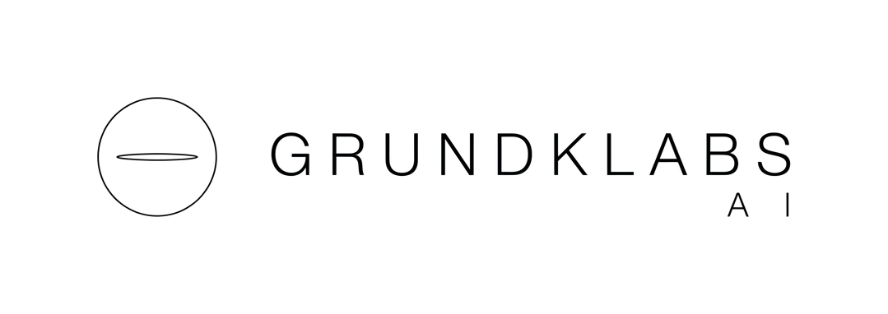

<p align="center">
  <picture>
    <source media="(prefers-color-scheme: dark)" srcset="https://raw.githubusercontent.com/GrundkLabs/.github/main/assets/logo-dark.png">
    
  </picture>
</p>

<p align="center"><sub>LOCAL-FIRST INTELLIGENCE&nbsp;&nbsp;·&nbsp;&nbsp;NO PUBLIC RECORD</sub></p>

---

## The lab

A private research group. No founder page. No team listing. No careers page and
no founding story you can check. The work is built, trained and served on
hardware we own, in places we do not describe, and nothing of yours is ever in
transit.

## GRN-1

```text
  GRN-1   ·   specification withheld
  ────────────────────────────────────
  status        in training
  weights       ████████████
  access        ████████████
  oversight     ████████████
  origin        ████████████
  intent        ████████████
```

One model. It answers to GRN-1, remembers what it is told, and is measured by
what it says rather than by what it scores. Everything else about it is
withheld until withholding it is no longer possible.

You will hear about it from somewhere other than this page.

<sub>This is the only page.</sub>
